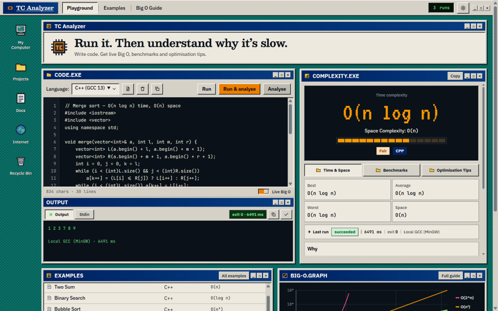
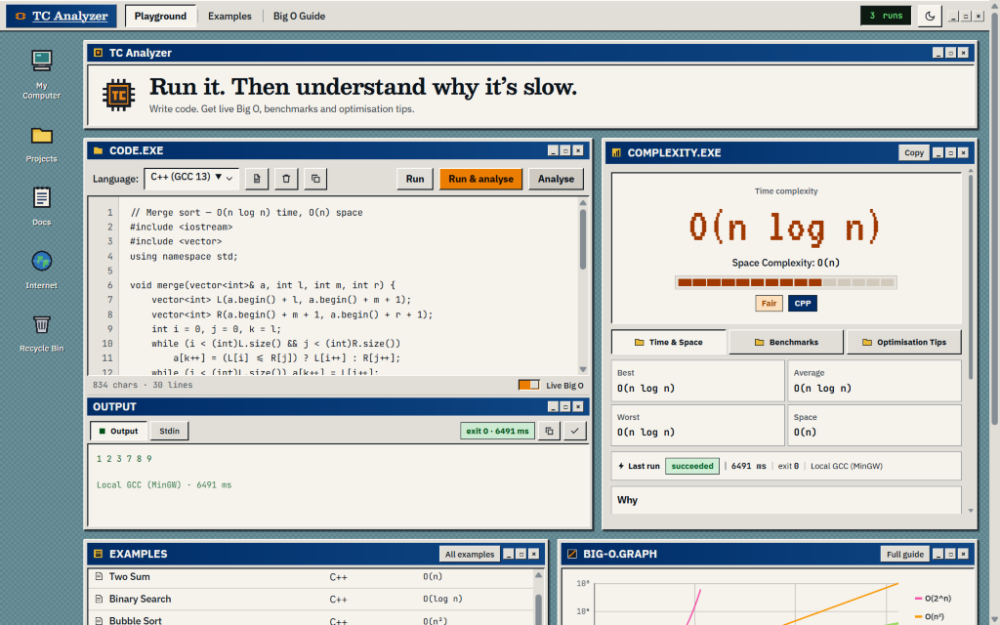
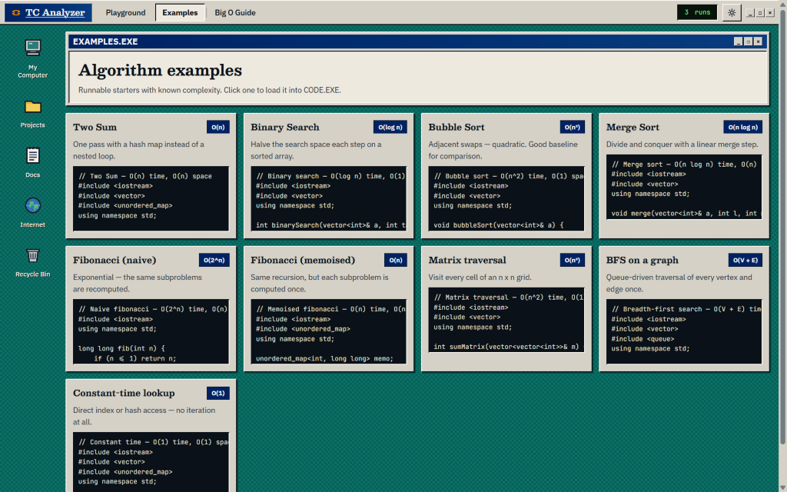
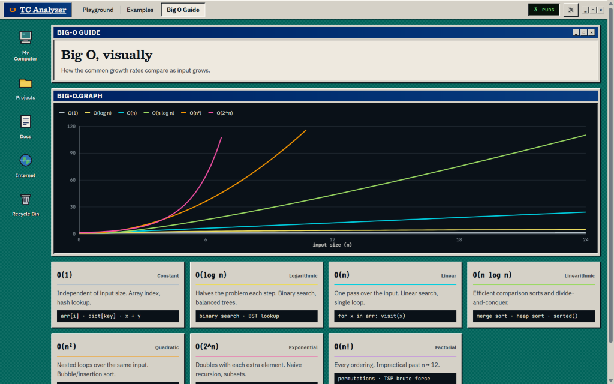
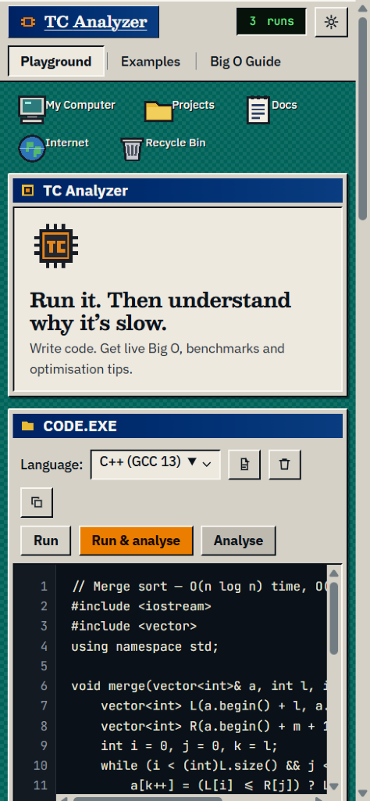

# TC Analyzer

Paste code, get its time and space complexity, and run it — all inside a retro 1995 desktop OS interface in the browser.

**Live site:** https://www.tcanalyzer.tech/



## What it does

- **Retro desktop workspace:** Styled like a classic 1995 OS with beveled window frames (`CODE.EXE`, `COMPLEXITY.EXE`, `OUTPUT`, `EXAMPLES`, `BIG-O.GRAPH`), navy title bars, an LCD-style run counter in the top taskbar, and a left desktop icon rail (`My Computer`, `Projects`, `Docs`, `Internet`, `Recycle Bin`).
- **Smart code editor (`CODE.EXE`):** Synced line-number gutter, character/line counter, **Live Big O** toggle, starter templates, bracket/quote auto-closing and selection wrapping, `Tab` / `Shift+Tab` block indentation, and smart `Enter` auto-indentation.
- **Big-O complexity readout (`COMPLEXITY.EXE`):** CRT readout with a 15-segment complexity meter, rating and language badges, quick-jump folder tabs (**Time & Space**, **Benchmarks**, **Optimisation Tips**), best/average/worst/space breakdown, last-run benchmark strip, assumptions, explanation, and optimisation hints.
- **Docked console (`OUTPUT`):** Executes code and displays output, exit code, and runtime in milliseconds, with a **Stdin** tab for program input.
- **Live growth graph & quick examples:** On the Playground tab, **EXAMPLES** lets you load any starter algorithm in one click while **BIG-O.GRAPH** plots common Big-O curves on a log scale and highlights the detected complexity.
- **Full Examples & Big O Guide tabs:** Dedicated **Examples** (`EXAMPLES.EXE`) gallery with 9 runnable C++ algorithm starters and a **Big O Guide** tab with an interactive growth-rate chart (`O(1)` to `O(2^n)`) and reference cards (`O(1)` to `O(n!)`).
- **History & draft persistence:** **RECENT RUNS** stores up to 15 analyses with complexity, snippet preview, language, runtime, and timestamp; your draft (`code`, `language`, `stdin`) is restored on reload.
- **Dark CRT & light themes:** Opens in the default dark CRT + teal desktop theme, with a light theme behind the top-right toggle. Responsive down to 390px wide and respects `prefers-reduced-motion`.

The analysis is static pattern-based estimation, not a proof. When the engine has to guess, it marks the result as `uncertain` and lists the assumptions it made.

<details>
<summary>More screenshots (light theme, Examples, Big O Guide, mobile)</summary>

| Light theme | Examples (`EXAMPLES.EXE`) |
|---|---|
|  |  |

| Big O Guide | Mobile (390px) |
|---|---|
|  |  |

</details>

## Supported languages

| Language | Analysed | Executed with |
|---|---|---|
| Python 3.12 | Yes | Pyodide (WebAssembly) in a Web Worker |
| JavaScript | Yes | Sandboxed Web Worker |
| C++ (GCC 13) | Yes | Wandbox remote compiler |
| C (GCC 13) | Yes | Wandbox remote compiler |
| Java (JDK 22) | Yes | Wandbox remote compiler |
| Go 1.23 | Yes | Wandbox remote compiler |
| Rust 1.82 | Yes | Wandbox remote compiler |
| Pseudocode | Yes | Not executed |

"Auto detect" picks the language from the code.

Local runs (JavaScript, Python) are stopped after 5 seconds, so an infinite loop cannot freeze the tab. Remote runs have a 90 second ceiling, because Go and Rust can take 20–30 seconds to compile on Wandbox.

## Keyboard shortcuts

| Keys | Action |
|---|---|
| `Ctrl`/`Cmd` + `Enter` | Analyse complexity |
| `Shift` + `Enter` | Run |
| `Ctrl`/`Cmd` + `Shift` + `Enter` | Run and analyse |
| `Esc` | Cancel a run in progress |
| `Ctrl`/`Cmd` + `Z` | Undo a template, example, history load, or Clear replacing your code |
| `Tab` / `Shift` + `Tab` | Indent or unindent the current line / selection (4 spaces) |

## Run it locally

There is no build step and there are no dependencies. You need Node.js only for the local server and the tests.

```bash
git clone https://github.com/japsaini0/TCAnalyzer.git
cd TCAnalyzer
node serve.js
```

Then open http://localhost:3000/.

The server binds to `127.0.0.1` on port 3000. Set `HOST` to change the bind address, for example `HOST=0.0.0.0 node serve.js`.

When the page is served from `localhost`, C, C++, Python and JavaScript runs go to the server's `/api/run` endpoint and use the `g++`, `gcc`, `python` and `node` found on your machine. Java, Go and Rust always go to Wandbox.

> `serve.js` executes whatever code it is sent, with your user's permissions. Keep it on `127.0.0.1` unless you trust everyone who can reach it.

You can also open the folder with any static file server. The app then behaves as it does in production.

## Tests

```bash
node test_regression.js
```

This runs 43 regression checks against the analysis engine and needs no browser.

## Project layout

| File | Purpose |
|---|---|
| `index.html` | Page markup for the retro OS desktop shell, tabs, and panes |
| `tokens.css` | Design tokens, typography (`Besley`, `IBM Plex Sans`, `VT323`, `JetBrains Mono`), and dark/light palettes |
| `base.css` | Reset, typography defaults, accessibility helpers, and `prefers-reduced-motion` |
| `styles.css` | Retro 3D bevel primitives, CRT panels, window chrome, and responsive layout |
| `app.js` | UI: tabs, desktop shortcuts, theme, smart editor, history, examples, guide charts |
| `analyzer.js` | The Big-O engine (`new ComplexityAnalyzer().analyze(code, lang)`) |
| `runner.js` | Code execution: workers, Pyodide, Wandbox |
| `serve.js` | Optional local server with native compilers |
| `test_regression.js` | Engine regression suite |
| `vercel.json` | Vercel config: CSP, security headers, caching |
| `CHANGES.md` | Changelog of previous rebuild and engine/runner bug fixes |
| `screenshots/` | Screenshots of the current retro desktop UI |

## Deployment

The site is a set of static files configured for Vercel through `vercel.json`. Any static host works, as long as its Content Security Policy allows `cdn.jsdelivr.net` (Pyodide), `wandbox.org` (remote compilers) and Google Fonts.

## Privacy

Theme, draft (`code`, `language`, `stdin`), run count and history are stored in your browser's local storage. Code is only sent off your machine when you run a compiled language, in which case it goes to Wandbox.
