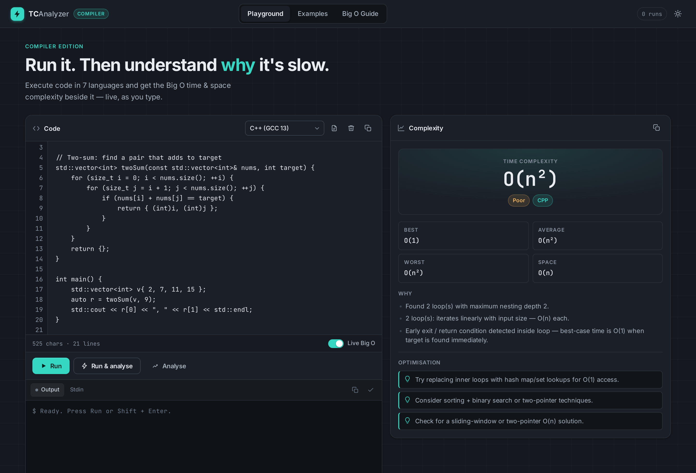

# TC Analyzer

Paste code, get its time and space complexity, and run it — all in the browser.

**Live site:** https://www.tcanalyzer.tech/



## What it does

- **Estimates Big-O** from source code: time complexity (best, average and worst case) and auxiliary space, with a short explanation and optimisation hints.
- **Runs the code** and shows output, exit status and runtime in a docked console, with a Stdin tab for input.
- **Keeps a history** of your last 15 analyses and restores your draft on reload.
- **Examples** tab with ready-made snippets, and a **Big O Guide** tab with a growth chart.
- Dark theme by default, with a light theme behind the toggle. Works down to 390px wide.

The analysis is static pattern-based estimation, not a proof. When the engine has to guess, it marks the result as uncertain and lists the assumptions it made.

## Supported languages

| Language | Analysed | Executed with |
|---|---|---|
| Python 3.12 | Yes | Pyodide (WebAssembly) in a Web Worker |
| JavaScript | Yes | Sandboxed Web Worker |
| C++ (GCC 13) | Yes | Wandbox remote compiler |
| C (GCC 13) | Yes | Wandbox remote compiler |
| Java (JDK 22) | Yes | Wandbox remote compiler |
| Go 1.23 | Yes | Wandbox remote compiler |
| Rust 1.82 | Yes | Wandbox remote compiler |
| Pseudocode | Yes | Not executed |

"Auto detect" picks the language from the code.

Local runs (JavaScript, Python) are stopped after 5 seconds, so an infinite loop cannot freeze the tab. Remote runs have a 90 second ceiling, because Go and Rust can take 20–30 seconds to compile on Wandbox.

## Keyboard shortcuts

| Keys | Action |
|---|---|
| `Ctrl`/`Cmd` + `Enter` | Analyse |
| `Shift` + `Enter` | Run |
| `Ctrl`/`Cmd` + `Shift` + `Enter` | Run and analyse |
| `Esc` | Cancel a run in progress |
| `Ctrl`/`Cmd` + `Z` | Undo a template or example replacing your code |

## Run it locally

There is no build step and there are no dependencies. You need Node.js only for the local server and the tests.

```bash
git clone https://github.com/japsaini0/TCAnalyzer.git
cd TCAnalyzer
node serve.js
```

Then open http://localhost:3000/.

The server binds to `127.0.0.1` on port 3000. Set `HOST` to change the bind address, for example `HOST=0.0.0.0 node serve.js`.

When the page is served from `localhost`, C, C++, Python and JavaScript runs go to the server's `/api/run` endpoint and use the `g++`, `gcc`, `python` and `node` found on your machine. Java, Go and Rust always go to Wandbox.

> `serve.js` executes whatever code it is sent, with your user's permissions. Keep it on `127.0.0.1` unless you trust everyone who can reach it.

You can also open the folder with any static file server. The app then behaves as it does in production.

## Tests

```bash
node test_regression.js
```

This runs 43 regression checks against the analysis engine and needs no browser.

## Project layout

| File | Purpose |
|---|---|
| `index.html` | Page markup |
| `styles.css` | Design tokens, light and dark themes, responsive layout |
| `app.js` | UI: tabs, theme, editor, history, examples, guide |
| `analyzer.js` | The Big-O engine (`new ComplexityAnalyzer().analyze(code, lang)`) |
| `runner.js` | Code execution: workers, Pyodide, Wandbox |
| `serve.js` | Optional local server with native compilers |
| `test_regression.js` | Engine regression suite |
| `vercel.json` | Vercel config: CSP, security headers, caching |
| `CHANGES.md` | Changelog of the redesign and bug fixes |
| `screenshots/` | Screenshots of the current design |

## Deployment

The site is a set of static files configured for Vercel through `vercel.json`. Any static host works, as long as its Content Security Policy allows `cdn.jsdelivr.net` (Pyodide), `wandbox.org` (remote compilers) and Google Fonts.

## Privacy

Theme, draft, run count and history are stored in your browser's local storage. Code is only sent off your machine when you run a compiled language, in which case it goes to Wandbox.
